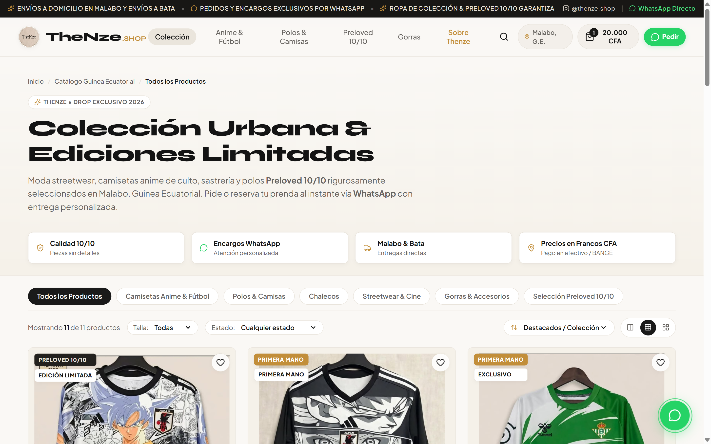
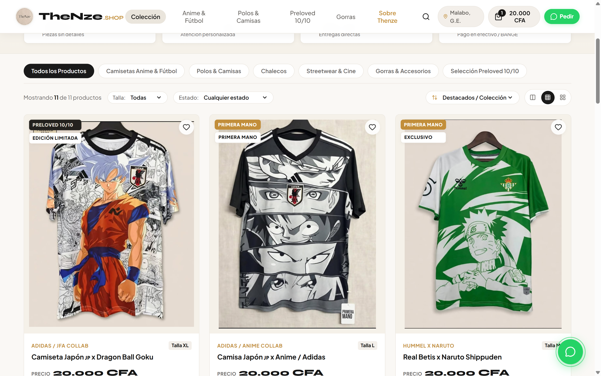
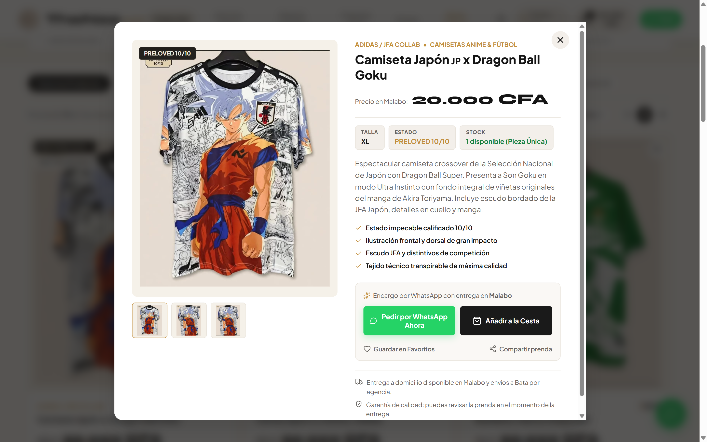
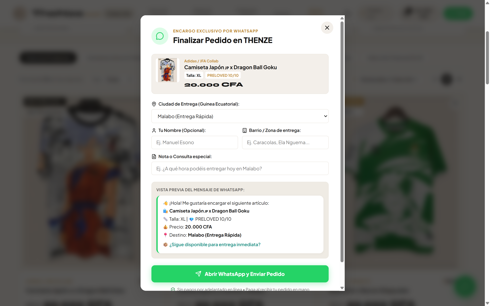
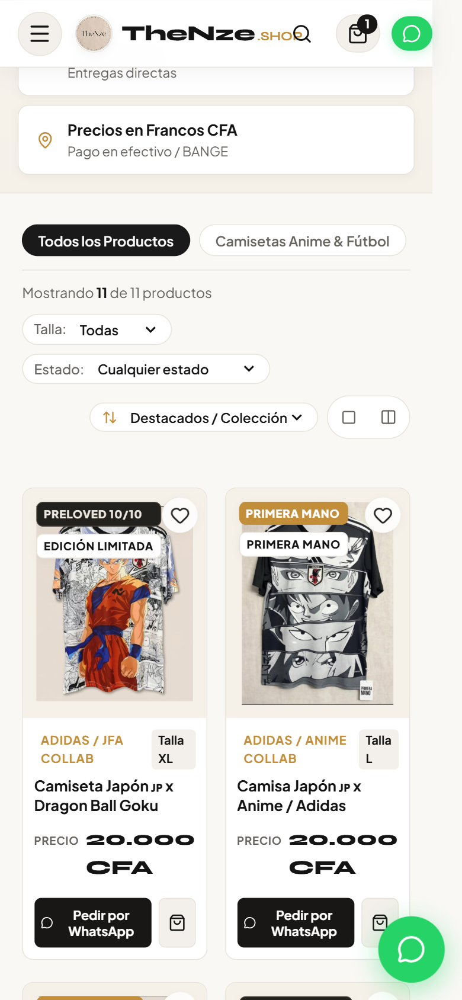
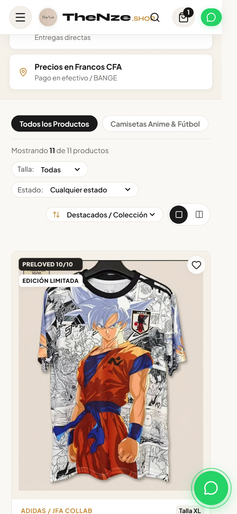
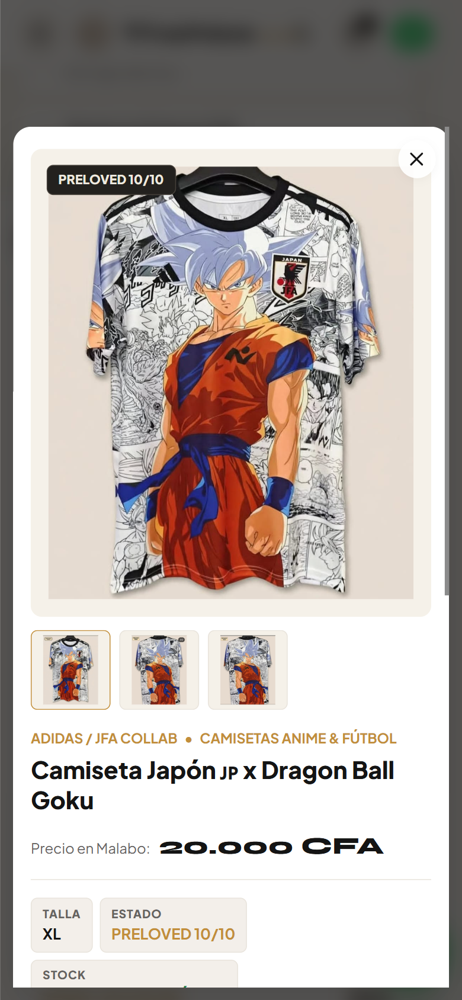
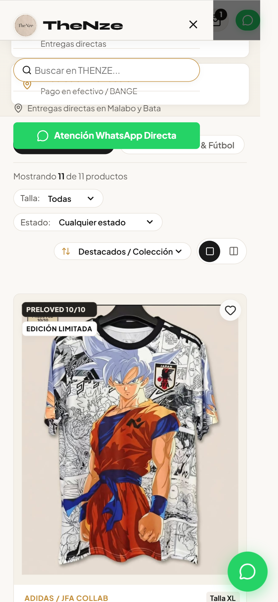

# THENZE.SHOP 🛒🔥
> **E-Commerce Showcase de Streetwear, Camisetas Anime Exclusivas & Selección Preloved 10/10 en Malabo, Guinea Ecuatorial**

[](https://tranquilino1.github.io/thenze-shop/)
[](https://www.instagram.com/thenze.shop/)
[](https://react.dev/)
[](https://vitejs.dev/)

---

## 🌐 Enlaces del Proyecto

* 🔗 **Live Demo (GitHub Pages):** [https://tranquilino1.github.io/thenze-shop/](https://tranquilino1.github.io/thenze-shop/)
* 📦 **Repositorio GitHub:** [https://github.com/Tranquilino1/thenze-shop](https://github.com/Tranquilino1/thenze-shop)
* 📸 **Instagram Oficial:** [@thenze.shop](https://www.instagram.com/thenze.shop/)

---

## 📸 Capturas de Pantalla de la Aplicación

### 1. 🖥️ Vista Desktop (PC & MacBook)

#### Encabezado, Colección y Barra de Filtros


#### Catálogo Completo con Precios en Francos CFA (XAF)


---

### 2. ⚡ Experiencia Interactiva & Flujo de Compra por WhatsApp

| Vista Rápida de Producto (Modal & Galería) | Checkout Concierge WhatsApp (Malabo / Bata) |
| :---: | :---: |
|  |  |

#### Carrito Lateral Deslizable (Multi-Producto con Cálculo en CFA)


---

### 3. 📱 Experiencia Móvil (iPhone iOS & Android)

| Cuadrícula Móvil de 2 Columnas | Vista Detallada de 1 Columna | Modal Bottom-Sheet Móvil |
| :---: | :---: | :---: |
|  |  |  |

#### Menú Lateral de Navegación en Smartphones


---

## 🌟 Características Destacadas

1. **Diseño Editorial de Alta Costura Urbana:**
   - Inspirado en tiendas de referencia internacional como **Sadie Co** y firmas streetwear de vanguardia.
   - Tipografía prémium con *Syne*, *Plus Jakarta Sans* y *Cinzel*.
   - Paleta de colores cálida (*cream, gold, deep charcoal*).

2. **Precios en Francos CFA (XAF):**
   - Catálogo 100% valorado en moneda oficial de Guinea Ecuatorial (`20.000 CFA`, `10.000 CFA`, `5.000 CFA`, `4.000 CFA`).

3. **Flujo de Pedido Concierge por WhatsApp (Estilo Ebna Luxury):**
   - En lugar de pasarelas de pago no disponibles localmente, las compras se gestionan mediante mensajes estructurados de **WhatsApp**.
   - Selector de ciudad de entrega (**Malabo** y **Bata**) y barrio de entrega.
   - Vista previa en vivo del mensaje con resumen de tallas, estado y precio.

4. **100% Responsivo en Todos los Dispositivos:**
   - **Smartphones (iOS & Android):** Cuadrícula adaptable de 2 columnas o 1 columna, barra de búsqueda expandible, y soporte de áreas seguras (`safe-area-inset`).
   - **Tabletas (iPad):** Distribución balanceada de 2 a 3 columnas.
   - **Portátiles y MacBooks:** Navegación superior completa y alternador de columnas (2, 3 o 4 columnas).

---

## 🛠️ Tecnologías Empleadas

* **Frontend:** React 18 (SPA)
* **Build Tool:** Vite 5
* **Iconografía:** Lucide React + Componentes SVG Personalizados
* **Estilos:** Vanilla CSS Design System (Variables CSS, Animaciones y Media Queries modernas)
* **Hosting:** GitHub Pages con ruta base automatizada

---

## 🚀 Despliegue y Ejecución Local

```bash
# Clonar repositorio
git clone https://github.com/Tranquilino1/thenze-shop.git
cd thenze-shop

# Instalar dependencias
npm install

# Iniciar servidor local
npm run dev

# Generar bundle de producción
npm run build

# Desplegar en GitHub Pages
npm run deploy # (o npx gh-pages -d dist)
```
